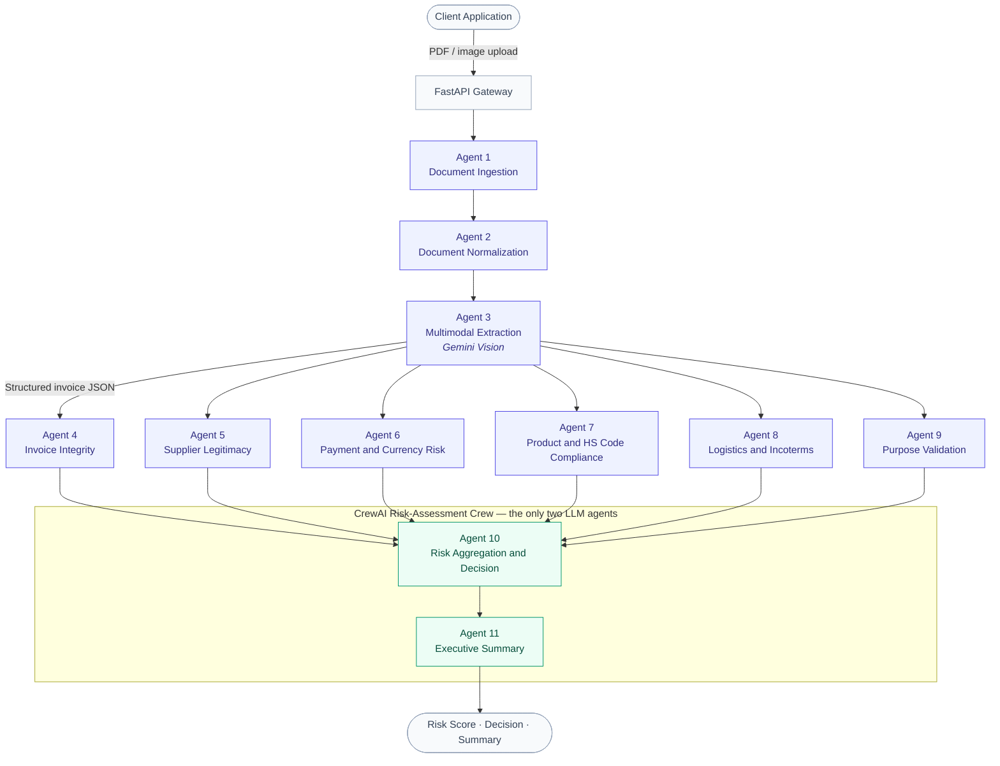

# Trade Service Agents

**Enterprise multi-agent AI platform for proforma invoice extraction, validation, and risk
assessment.**


Trade Service Agents automates the review of proforma invoices for foreign exchange and trade
finance teams. It combines multimodal AI extraction, an 11-agent risk assessment architecture
built on [CrewAI](https://docs.crewai.com/), and deterministic, auditable scoring logic to
produce a clear, explainable risk decision for every invoice.

See [`docs/ARCHITECTURE.md`](docs/ARCHITECTURE.md) for the full design document, including the
business context, agent responsibilities, and system architecture diagram.

## Key Features

- **Multimodal extraction** — Google Gemini vision model reads PDF or image invoices into
  structured JSON.
- **11-agent risk architecture** — six deterministic risk-dimension checks (invoice integrity,
  supplier legitimacy, payment & currency risk, product & HS code compliance, logistics &
  incoterms, purpose validation) feed a CrewAI aggregation agent and an executive summary agent.
- **Under/over-invoicing detection** — an optional check compares the declared unit price
  against a customs commission indicative-price reference table (matched by HS code and
  description similarity), flagging classic duty-evasion and trade-based money-laundering
  signals when configured.
- **Deterministic, auditable scoring** — every risk number is computed by a pure Python function;
  agents explain results, they never invent them.
- **Composable weighting** — category weights and decision thresholds are defined in one place
  ([`scoring/aggregation.py`](src/trade_service_agents/scoring/aggregation.py)) and easy to tune.

## Architecture at a Glance

Eleven purpose-built agents move a proforma invoice from raw document to auditable decision.
Agents 1–9 are deterministic — document handling, multimodal extraction, and all six
risk-dimension checks run as direct Python/API calls, with no LLM round-trip to rate-limit,
misjudge, or bill for. Only agent 10 (which must weigh six numbers it didn't compute) and
agent 11 (which writes prose) go through an actual CrewAI/LLM crew — keeping a full analysis
to about **3 API calls** instead of the 15-17 a naive "one agent per task" design would cost.



**🟦 Deterministic pipeline** (agents 1-9 — pure Python/API calls, no LLM) · **🟩 CrewAI crew**
(agents 10-11 — the only two that call Gemini, guarded so the aggregation agent can never
invent its own weighting math)

Every score above is computed by a pure Python function in
[`scoring/`](src/trade_service_agents/scoring/); agent 10 calls the same aggregation logic as
a CrewAI tool so its final decision is still explainable in agent terms, and agent 11 turns
that decision into a business-readable summary. Full agent-by-agent responsibilities:
[`docs/ARCHITECTURE.md`](docs/ARCHITECTURE.md).

## Project Structure

```
src/trade_service_agents/
├── core/            # settings, logging
├── models/          # ProformaInvoice, risk output schemas
├── extraction/       # Agents 1-3: ingestion, normalization, multimodal extraction
├── scoring/         # Deterministic risk-scoring functions (Agents 4-10 math)
├── agents/           # CrewAI crew: agents, tasks, tools, LLM config
├── services/         # Orchestration: extraction -> crew -> response
└── api/               # FastAPI app and routes
tests/
├── test_scoring/     # Unit tests for the deterministic scoring engine
└── test_api/         # API tests with the crew/LLM mocked
```

## Quick Start

### Prerequisites

- Python 3.10–3.13
- [`poppler-utils`](https://poppler.freedesktop.org/) (required by `pdf2image` for PDF support)
  ```bash
  sudo apt-get install poppler-utils   # Debian/Ubuntu
  brew install poppler                 # macOS
  ```
- A Google Gemini API key

### Installation

```bash
python3 -m venv .venv
source .venv/bin/activate
make install        # pip install -e ".[dev]"
```

### Configuration

```bash
cp .env.example .env
# then set GENAI_API_KEY in .env
```

**Under/over-invoicing detection** works out of the box — a customs commission indicative-price
workbook ships with the package and is used automatically to flag prices that deviate
suspiciously from the reference in the Product & HS Code Compliance category. Set
`CUSTOMS_PRICE_LIST_PATH` in `.env` only if you want to override it with an updated or
different price list (`.xlsx`, columns: HS code, description, unit of measure, origin, unit
price); the check silently no-ops rather than erroring if the configured file can't be read.

### Run

```bash
make run             # uvicorn trade_service_agents.api.app:app --reload
```

The API is served at `http://localhost:8000`, with interactive docs at `/docs`.

## Docker Deployment

```bash
git clone git@github.com:CoopDxValley/trade-service-agents.git
cd trade-service-agents
cp .env.example .env
# edit .env: set GENAI_API_KEY (HOST_PORT already defaults to 8050)

docker compose up -d --build
```

That's it — nothing else to configure or copy onto the server. The API is served at
`http://<this-host>:8050` (or whatever `HOST_PORT` you set), with interactive docs at
`http://<this-host>:8050/docs`.

- `docker-compose.yml` builds the image from the repo's `Dockerfile`, maps `HOST_PORT` to
  the container's internal port 8000, and loads all other settings from `.env`. The customs
  reference-price workbook ships inside the image, so under/over-invoicing detection works
  immediately with no separate file to place on the host.
- To update after a `git pull`: `docker compose up -d --build` again (rebuilds only if
  something changed).
- Logs: `docker compose logs -f`. Stop: `docker compose down`.

## API Reference

| Method | Endpoint            | Description                                                              |
|--------|----------------------|----------------------------------------------------------------------------|
| `GET`  | `/health`            | Liveness check.                                                            |
| `POST` | `/extract`           | Extract generic invoice fields from an uploaded PDF/image.                |
| `POST` | `/extract_proforma`  | Extract full structured proforma invoice data from an uploaded PDF/image. |
| `POST` | `/analyze_proforma`  | Run the full 11-agent risk assessment on structured invoice data.         |

`POST /analyze_proforma` accepts a JSON body matching
[`ProformaInvoice`](src/trade_service_agents/models/invoice.py) and returns:

```json
{
  "summary": "string",
  "risk": {
    "finalRiskScore": 0.0,
    "riskCategory": "Very Low | Low-Medium | Medium-High | High | Critical",
    "decision": "string",
    "categoryBreakdown": { "invoiceIntegrity": 0, "...": 0 }
  },
  "insights": ["string"],
  "recommendations": ["string"],
  "invoiceAnomalyIndex": 0.0
}
```

## Testing

```bash
make test            # pytest
make lint            # ruff check
```

Scoring tests run entirely offline against the deterministic functions. API tests mock the
CrewAI crew and the Gemini client, so the full suite runs without network access or an API key.

## License

Licensed under the [Apache License 2.0](LICENSE).
# AI-Agent
