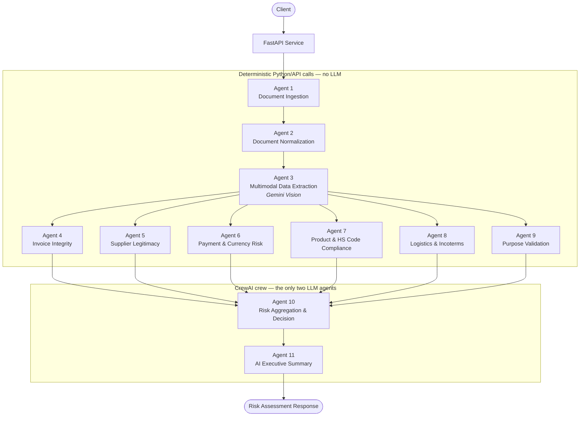

# Architecture & Design Document

## 1. Executive Summary

This document outlines the design and implementation of an **Enterprise Multi-Agent AI Platform**
developed to automate the extraction, validation, and risk assessment of proforma invoices.

The solution combines multimodal artificial intelligence, domain-specific analytical agents, and
deterministic risk scoring logic to deliver accurate, explainable, and auditable compliance
decisions.

The platform is designed to support financial operations, trade finance, and compliance teams by
reducing manual review effort, improving decision consistency, and enabling scalable risk
management.

## 2. Business Context and Objectives

Proforma invoice review is a critical control point in foreign exchange and trade transactions.
Traditional manual processes are:

- Labor-intensive and slow
- Highly dependent on reviewer experience
- Prone to inconsistency and human error
- Difficult to scale with growing transaction volumes

The objective of this system is to introduce a structured, AI-driven approach that ensures:

- Standardized risk evaluation
- Faster processing times
- Improved compliance and fraud detection
- Clear auditability and transparency

## 3. Solution Overview

The platform is implemented as a **FastAPI**-based service that processes invoice documents in
PDF or image format.

The system applies a multi-agent AI architecture, where each agent is responsible for analyzing a
specific risk dimension. The six independent risk-dimension agents operate concurrently, with
their outputs aggregated into a final risk score and approval recommendation by a dedicated
aggregation agent.

The final response includes:

- A numerical risk score (0–100)
- A categorized risk level
- A decision recommendation
- Key insights and remediation actions
- An AI-generated executive summary

## 4. Multi-Agent Architecture Design

### Architectural Principles

- **Modularity** — each agent has a single, well-defined responsibility
- **Independence** — the six risk-dimension agents evaluate the invoice independently of one another
- **Explainability** — every risk signal is traceable to a specific agent and a deterministic function
- **Extensibility** — new agents can be introduced without redesigning the pipeline
- **Cost-awareness** — an agent only calls a language model when it genuinely needs one

### Framework

Agents 1–9 run as deterministic Python/API calls — document handling, multimodal extraction,
and all six risk-dimension checks are pure functions with no language-model reasoning involved,
so none of them can be rate-limited, mis-score an invoice, or consume a scarce API quota. Only
agents 10 and 11 are implemented with **[CrewAI](https://docs.crewai.com/)**: agent 10 must
weigh six numbers it did not itself compute (a genuine tool-calling decision), and agent 11
must produce business prose (a genuine language task). Both call a deterministic Python
function under the hood where one exists — agent 10 through a CrewAI tool wrapping the same
aggregation logic — so every numerical output is still auditable and reproducible, while a
full analysis costs on the order of 3 LLM calls rather than one per agent.

## 5. Agent Responsibilities and Functional Scope

### 5.1 Document Ingestion Agent

- Accepts invoice uploads via the API
- Validates file type and content integrity
- Initiates the processing pipeline

### 5.2 Document Normalization Agent

- Converts PDFs into image pages
- Standardizes input for downstream AI processing

### 5.3 Multimodal Data Extraction Agent

- Utilizes a vision-enabled large language model (Google Gemini)
- Extracts structured invoice data into JSON format
- Captures supplier, client, pricing, logistics, and payment details

### 5.4 Invoice Integrity Agent

- Verifies invoice arithmetic and totals
- Checks invoice number and date validity
- Flags missing or inconsistent invoice metadata

### 5.5 Supplier Legitimacy Agent

- Analyzes supplier name, address, and origin
- Flags non-commercial or residential indicators
- Identifies potential supplier authenticity risks

### 5.6 Payment & Currency Risk Agent

- Detects mismatches between currency and payment terms
- Flags high-risk settlement methods
- Scores payment-related compliance risk

### 5.7 Product & HS Code Compliance Agent

- Validates HS codes against product descriptions
- Detects abnormal pricing patterns
- Flags incomplete or vague item information

### 5.8 Logistics & Incoterms Agent

- Evaluates alignment between incoterms and transport modes
- Detects shipping anomalies
- Flags missing or inconsistent logistics data

### 5.9 Purpose Validation Agent

- Verifies alignment between stated purpose, goods, and quantities
- Identifies inconsistencies indicating potential misuse

### 5.10 Risk Aggregation & Decision Agent

- Applies weighted scoring across all agent outputs
- Calculates the final risk score
- Determines the approval or escalation decision

### 5.11 AI Executive Summary Agent

- Produces a concise, business-friendly summary
- Highlights critical risks and key recommendations
- Designed for senior decision-makers

## 6. System Architecture Diagram

Agents 1–9 run as direct Python/API calls, not CrewAI agents — document handling, multimodal
extraction, and every risk-dimension check are pure functions with nothing to rate-limit or
mis-score. Only agent 10 (weighing six scores it did not compute) and agent 11 (writing the
summary) go through the CrewAI crew, which keeps a full analysis to roughly 3 LLM calls.

## 7. Risk Scoring and Decision Framework

- Each of the six risk-dimension agents produces an independent, deterministic risk score (0–100)
- Scores are weighted according to regulatory and business importance
- The final score determines:
  - Risk category (**Very Low** → **Low-Medium** → **Medium-High** → **High** → **Critical**)
  - Required approval level
  - Recommended next action

| Final Score | Risk Category | Decision                     |
|-------------|----------------|-------------------------------|
| 0–20        | Very Low       | Auto-approve                  |
| 21–40       | Low-Medium     | Normal approval workflow      |
| 41–65       | Medium-High    | Request clarification         |
| 66–85       | High           | Management-level approval     |
| 86–100      | Critical       | Reject or escalate            |

All scoring logic is deterministic, auditable, and configurable — implemented as pure Python
functions in `src/trade_service_agents/scoring/`, independent of the language model.

## 8. Business and Operational Benefits

- Significant reduction in manual review effort
- Faster and more consistent decision-making
- Improved fraud and anomaly detection
- Clear audit trail for regulators and auditors
- Scalable foundation for future compliance requirements
